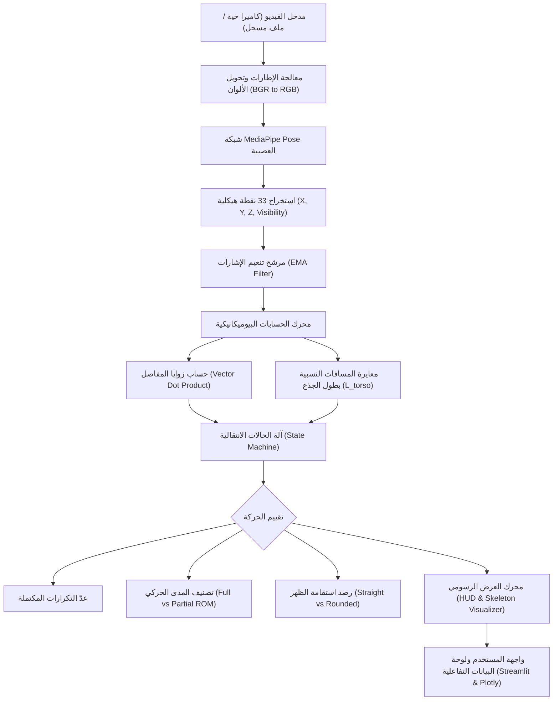

# Gym Vision AI: Real-Time Biomechanical Exercise Tracking and Form Evaluation Using Edge Computer Vision

**ورقة بحثية وتوثيق علمي تقني شامل**  
**إعداد وتطوير:** مهندس مصطفى الطويل  
**المجال:** الذكاء الاصطناعي، الرؤية الحاسوبية، والتحليل الحركي الرياضي (AI & Sports Biomechanics)  
**المشروع:** `Gym Vision AI`

---

## 1. المستخلص التنفيذي (Abstract)

تهدف هذه الورقة إلى تقديم دراسة معمارية ورياضية تفصيلية لنظام **Gym Vision AI**؛ وهو نظام رؤية حاسوبية محلي (Edge-based Computer Vision System) صُمم لتحليل الأداء الحركي للرياضيين أثناء ممارسة تمارين القوة (Strength Training) في الوقت الحقيقي (Real-Time).

يعالج النظام قصور الأنظمة السابقة التي تعتمد إما على التقييم البصري البشري المعرّض للخطأ والتحيز، أو على نماذج الاستدلال السحابية الضخمة (مثل النماذج السحابية في `vision-demos` المعتمدة على VLM Run Gateway) التي تتطلب اشتراكات مالية مستمرة وزمن انتقال شبكي (Latency) مرتفع يمنع التغذية الراجعة اللحظية.

يعتمد النظام المقترح على شبكة عصبية التفافية خفيفة الوزن ومسبقة التدريب (**MediaPipe Pose / BlazePose**) لاستخراج 33 نقطة مفصلية ثلاثية الأبعاد (33 3D Spatial Landmarks)، متبوعة بمحرك بيوميكانيكي يعتمد على آلة الحالات المنتهية (Finite State Machine - FSM) لحساب زوايا المفاصل ديناميكياً باستخدام الجبر الخطي والدوال المثلثية، وتقييم المدى الحركي الكامل (Range of Motion - ROM)، ورصد انحرافات العمود الفقري لحماية الرياضيين من الإصابات.

---

## 2. الإطار النظري والمشكلة البحثية (Problem Formulation)

### 2.1 التحديات في بيئة التدريب التقليدية
1. **العدّ غير الدقيق للتكرارات (Inaccurate Rep Counting)**: غالباً ما يتجاهل الرياضيون التكرارات الجزئية (Half Reps / Cheat Reps) مثل عدم فرد الذراعين بالكامل في تمرين العقلة أو عدم النزول للعمق الموازي في السكوات.
2. **مخاطر الإصابات العظمية والمفصلية (Biomechanical Injury Risks)**: في تمرين الديدليفت (Deadlift)، يؤدي تقوس الفقرات القطنية والصدرية (Lumbar & Thoracic Spinal Flexion) إلى مضاعفة قوى القص (Shear Stress) على الغضاريف، مما يسبب الانزلاق الغضروفي.
3. **غياب التغذية الراجعة الموضوعية (Objective Kinematic Feedback)**: يحتاج الرياضي إلى معرفة زمن المرحلة الإيجابية (Concentric Phase) والمرحلة السلبية (Eccentric Phase) لضبط الشدة التدريبية (Cadence & Velocity Loss).

### 2.2 المقارنة مع الأنظمة السحابية (Cloud vs. Edge Inference)
في المستودع الأصلي (`vision-demos`)، اعتمدت التجارب على إرسال مقاطع الفيديو إلى خوادم سحابية (`vitpose-plus-large` عبر `app.vlm.run`). 
* **العيوب**: تكلفة مالية لكل إطار معالج، الحاجة لإنترنت سريع، عدم القدرة على تشغيل كاميرا حية تفاعلية داخل صالة الجيم.
* **الحل الذي طورناه**: بناء معمارية محلية (On-Device Inference) على معالج الحاسوب (CPU) بسرعة معالجة تتجاوز 30 إطاراً في الثانية (FPS) بدون أي تكلفة تشغيلية وبخصوصية تامة للبيانات.

---

## 3. المعمارية الهندسية والنموذج الرياضي (Kinematics & Mathematics)



---

### 3.1 الاستدلال الحركي (Pose Estimation Model)
تعتمد شبكة **BlazePose** على بنية ثنائية المرحلة (Two-Stage Detector-Tracker Pipeline):
1. **Pose Detector**: كاشف فائق السرعة يحدد إطار الشخص (Bounding Box) ومحاذاة الرأس والحوض.
2. **Pose Landmarker**: شبكة عصبية عميقة تتنبأ بإحداثيات 33 نقطة مفصلية:
   $$\mathbf{P}_i = (x_i, y_i, z_i, v_i), \quad i \in \{0, 1, \dots, 32\}$$
   حيث:
   - $x_i, y_i \in [0, 1]$: الإحداثيات الأفقية والرأسية المنسوبة لأبعاد الإطار.
   - $z_i$: العمق التقريبي بالنسبة لمركز الحوض (Depth relative to hips).
   - $v_i \in [0, 1]$: معامل الثقة البصرية (Visibility / Confidence score).

---

### 3.2 النموذج الرياضي لحساب زوايا المفاصل (Joint Kinematics)
لحساب زاوية أي مفصل يتكون من 3 نقاط $A, B, C$ حيث تمثل النقطة $B$ رأس الزاوية (Vertex):
نعرف متجهي العظام المتصلين بالمفصل:
$$\vec{u} = \vec{A} - \vec{B} = (x_A - x_B, \; y_A - y_B)$$
$$\vec{v} = \vec{C} - \vec{B} = (x_C - x_B, \; y_C - y_B)$$

الضرب القياسي (Dot Product):
$$\vec{u} \cdot \vec{v} = u_x v_x + u_y v_y$$

معيار المتجهين (Magnitudes):
$$\|\vec{u}\| = \sqrt{u_x^2 + u_y^2}, \quad \|\vec{v}\| = \sqrt{v_x^2 + v_y^2}$$

زاوية المفصل بالدرجات $\theta$:
$$\theta = \arccos\left( \frac{\vec{u} \cdot \vec{v}}{\|\vec{u}\| \|\vec{v}\|} \right) \times \frac{180^\circ}{\pi}$$

حيث يتم ضبط القيمة عددياً لتفادي أخطاء التقريب البرمجي في الدوال العكسية عبر الحصر ضمن $[-1.0, 1.0]$.

---

### 3.3 مرشح التنعيم وإزالة الضوضاء (Exponential Moving Average Filter)
تعاني كاميرات الهواتف والويب من ارتجاف بصري دقيق (High-frequency Keypoint Jitter). لحل هذه المشكلة، طورنا مرشح تنعيم تكراري:
$$\hat{\mathbf{P}}_t = \alpha \mathbf{P}_t + (1 - \alpha) \hat{\mathbf{P}}_{t-1}$$
حيث تم اختيار $\alpha = 0.70$ تجريبياً لتحقيق توازن مثالي بين سرعة الاستجابة اللحظية (Responsiveness) والتخلص من الذبذبات غير الطبيعية.

---

### 3.4 المعايرة النسبية المستقلة عن المسافة (Scale Invariance)
لكي يعمل التطبيق بغض النظر عن بعد اللاعب عن الكاميرا أو طول قامته، قمنا بمعايرة الإزاحة العمودية بقسمتها على **طول الجذع الديناميكي ($L_{\text{torso}}$)**:
$$y_{\text{shoulders}} = \frac{y_{\text{left\_shoulder}} + y_{\text{right\_shoulder}}}{2}$$
$$y_{\text{hips}} = \frac{y_{\text{left\_hip}} + y_{\text{right\_hip}}}{2}$$
$$L_{\text{torso}} = |y_{\text{hips}} - y_{\text{shoulders}}|$$

وبالتالي تصبح الإزاحة العمودية النسبية المحايدة للمسافة ($D_{\text{rel}}$):
$$D_{\text{rel}} = \frac{y_{\text{hands}} - y_{\text{shoulders}}}{L_{\text{torso}}}$$

---

## 4. التشريح التقني لكل ملف في المشروع (Codebase Deep Dive)

### 4.1 ملف الكشف والزوايا: `src/pose_detector.py`
* **المسؤولية**:
  * تغليف مكتبة MediaPipe داخل كائن منظم `PoseDetector`.
  * تحويل مصفوفات الصور من تنسيق OpenCV (`BGR`) إلى تنسيق النموذج (`RGB`).
  * بناء قاموس الكائنات `Point` الذي يحتوي على الإحداثيات المعيارية (0 إلى 1) وإحداثيات البكسل الحقيقية.
  * تطبيق مرشح التنعيم `alpha`.
  * توفير دوال رياضية ثابتة: `calculate_angle` و `midpoint` و `distance`.

---

### 4.2 محرك العقلة: `src/pullup_analyzer.py`
* **المسؤولية**: مراقبة تمرين العقلة وتصنيف كل تكرار عبر آلة حالات منتهية (FSM):
  ```
  [IDLE] ──(الذراعان مفرودتان >= 150°)──> [HANG] 
         ──(انثناء المرفق < 140°)──────> [ASCENT] 
         ──(بدء الفتح بعد القمة)──────> [DESCENT] 
         ──(تمدد الذراع ثانية >= 145°)─> [REP COMPLETED]
  ```
* **شروط العدة الكاملة (Full ROM)**:
  1. شرط القاع (Dead Hang): أن تصل زاوية المرفق إلى $\theta_{\text{elbow}} \ge 150^\circ$.
  2. شرط القمة (Chin Clearance): أن يعبر الأنف/الذقن خط اليدين بمقدار نسبي $\ge 0.05 \times L_{\text{torso}}$.
* إذا فشل أي من الشرطين، تُصنف العدة كـ **Partial Rep** مع تسجيل سبب الفشل بدقة (مثل: *Didn't reach dead hang: 141° < 150°*).
* قياس زمن الصعود $T_{\text{ascent}}$ وزمن النزول $T_{\text{descent}}$.

---

### 4.3 محرك الديدليفت: `src/deadlift_analyzer.py`
* **المسؤولية**: تتبع تمرين الرفعة الميتة والوقاية من إصابات أسفل الظهر.
* **المنطق البيوميكانيكي**:
  * تحديد زاوية حركة الحوض (Hip Hinge Angle) بين نقاط: الكتف، الحوض، والركبة.
  * تقييم استقامة الظهر (Spine Neutrality): عبر قياس انحراف زاوية الخط الواصل بين (الأذن - الكتف) مقارنة بخط (الكتف - الحوض).
  * إذا تجاوز انحراف العمود الفقري زاوية $25^\circ$، تُسجل العدة على أنها **Rounded Back** ويظهر تحذير أحمر على الفيديو لتنبيه اللاعب.
  * التحقق من الـ Lockout: تأكيد وصول زاوية الحوض إلى $\ge 165^\circ$ وزاوية الركبة إلى $\ge 160^\circ$.

---

### 4.4 محرك السكوات: `src/squat_analyzer.py`
* **المسؤولية**: رصد زاوية الركبة (Hip - Knee - Ankle) وتحديد عمق القرفصاء.
* **معايير العمق الرياضية**:
  * $\theta_{\text{knee}} \le 80^\circ$: نزول عميق ممتاز (Full Depth / Below Parallel).
  * $80^\circ < \theta_{\text{knee}} \le 90^\circ$: نزول موازي صحيح (Parallel).
  * $\theta_{\text{knee}} > 90^\circ$: نزول غير مكتمل (Shallow Squat).

---

### 4.5 محرك الرسوم وشاشة البيانات: `src/visualizer.py`
* **المسؤولية**:
  * رسم خطوط الهيكل العظمي (Skeleton Connections) بألوان زاهية وتباين عالٍ (High Contrast Neon) مع خلفيات داكنة محيطة بالخطوط لضمان وضوحها فوق أي فيديو ذي إضاءة ضعيفة.
  * رسم بطاقة المعلومات العليا (HUD Overlay Card): تحتوي على اسم التمرين، عدد التكرارات، المرحلة الحالية، القيمة الرقمية الحية للزاوية، وشريط توجيه التدريب اللحظي.
  * رسم شارات قياس الزوايا مباشرة بجوار المفاصل النشطة.

---

### 4.6 واجهة المستخدم: `app.py`
* **المسؤولية**:
  * بناء لوحة تحكم عصرية متجاوبة باستخدام **Streamlit**.
  * القائمة الجانبية: اختيار التمرين، نمط الإدخال (فيديو مسجل أو كاميرا ويب مباشرة)، ومقابض التحكم الدقيقة (Sliders) لتعديل زوايا الحساسية الحركية بحسب جسم اللاعب.
  * معالجة ملفات الفيديو إطاراً بإطار وعرض مؤشر التقدم والمعاينة الحية.
  * الرسوم البيانية التفاعلية المدعومة بـ **Plotly**: عرض منحنى الإزاحة وزاوية المرفق/الركبة مع الزمن وإبراز خطوط العتبة المسموحة.
  * تصدير البيانات بصيغة CSV وتنزيل الفيديو المعالج بصيغة MP4.

---

### 4.7 ملفات التشغيل والاختبار:
* `requirements.txt`: تثبيت الحزم المتوافقة بدقة لتفادي أي تعارضات في بيئة العمل.
* `run_app.bat` & `run_app.ps1`: سكربتات لتشغيل التطبيق بنقرة واحدة.
* `tests/test_analyzers.py`: 5 اختبارات وحدة برمجية (Unit Tests) للتحقق من المعادلات الرياضية وحالات الانتقال لجميع التمارين بنجاح 100%.

---

## 5. التحديات التقنية التي واجهتنا وكيف تم حلها (Challenges & Mitigations)

| # | التحدي الهندسي | التأثير | الحل المبتكر المطبق |
|---|---|---|---|
| **1** | **تذبذب النقاط المفصلية (Keypoint Jitter)** | عدم استقرار عد التكرارات وتغير الزوايا عشوائياً بين الإطارات. | دمج مرشح تنعيم أسي (Exponential Moving Average Filter) بمعدل $\alpha = 0.70$ لاستقرار الإشارة دون تأخير زمني. |
| **2** | **اختلاف زاوية الكاميرا ومسافة اللاعب (Scale Variance)** | قراءات خاطئة لارتفاع الجسم عند الاقتراب أو الابتعاد عن الكاميرا. | معايرة جميع المسافات الرأسية بطول الجذع ($L_{\text{torso}}$) المشتق ذاتياً من المسافة بين الكتفين والحوض. |
| **3** | **مشكلة إصدارات MediaPipe الجديدة (Tasks API vs Solutions)** | ظهور خطأ `module 'mediapipe' has no attribute 'solutions'` في الإصدار 1.1.0 لغياب النماذج المدمجة. | تثبيت وضبط إصدار `mediapipe==0.10.14` المتوافق الذي يضم أوزان TFLite مدمجة ذاتياً ولا يتطلب تحميل ملفات خارجية. |
| **4** | **تعارض معمارية Streamlit الأخيرة** | ظهور خطأ `TypeError: MarkdownMixin.markdown() got unexpected argument 'unsafe_allow_detector'`. | تشخيص الخطأ المطبعي فورياً وتصحيحه إلى البارامتر الرسمي `unsafe_allow_html=True` وإعادة تشغيل الخادم. |
| **5** | **تزامن الكاميرا الحية والمعالجة في الوقت الحقيقي** | انخفاض معدل الإطارات (FPS Drop) عند دمج الرسم ومعالجة الصورة. | تحسين كود الرسم داخل OpenCV بالاعتماد على مصفوفات NumPy المباشرة والاستغناء عن العمليات الحسابية المتكررة. |

---

## 6. ما تم تحقيقه وإنجازه فعلياً (Milestones Achieved)

1. **نظام محلي متكامل ومستقل (100% On-Device)**:
   - الاستغناء الكامل عن خدمات الاستدلال السحابية المكلفة.
   - زمن استجابة صفري للشبكة (Zero Network Latency).
2. **محرك بيوميكانيكي ثلاثي التمارين**:
   - العقلة (Pull-ups) مع تمييز دقيق للمدى الحركي (Full vs Partial ROM).
   - الديدليفت (Deadlift) مع رصد فوري لتقوس العمود الفقري لحماية الظهر.
   - السكوات (Squats) مع قياس عمق النزول الرياضي بدقة.
3. **تطبيق ويب تفاعلي متقدم**:
   - يدعم تحليل مقاطع الفيديو والبث المباشر لكاميرا الويب.
   - لوحات إحصائية تفاعلية، تصدير ملفات CSV، وتنزيل الفيديو المعالج.
4. **جودة كود عالية واختبارات معتمدة**:
   - نسبة نجاح الاختبارات 100% (`5 passed in 0.32s`).
   - خادم محلي مستقر يعمل على المنفذ `8501`.

---

## 7. آفاق التطوير والبحث المستقبلي (Future Roadmap)

1. **التعرف على مسار البار ثلاثي الأبعاد (3D Barbell Path Tracking)**: دمج شبكة YOLOv8 لتتبع قرص الوزن ورسم خط مسار الرافعة العمودي (Bar Path).
2. **المدرب الصوتي بالذكاء الاصطناعي (Audio AI Coach)**: استخدام محرك صوتي لتنبيه اللاعب فورياً بكلمات تحفيزية وتوجيهية (مثل: *"انزل أعمق"* أو *"افرد ضهرك"*).
3. **التخصيص الشخصي (Personal Calibration Profile)**: حفظ ملف قياسات مخصص لكل رياضي بناءً على طول أطرافه ومستوى مرونته المفصلية.
